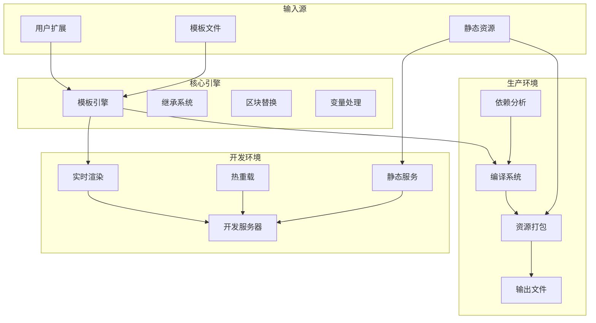

# @flun/html-template

## 简介

HTML 模板工具包,提供开发服务器和模板编译功能,支持自定义标签与快捷输入、变量定义、包含文件引用,帮助开发者模块化处理 HTML;

**本包基于 ESM 模块系统编写**

- **推荐方式**:使用 `import` / `export` 语法,静态分析更友好,工具链兼容性最佳;
- **兼容方式**:Node.js ≥ 23.5.0 原生支持 `require(esm)`;22.12+ 需开启 `--experimental-require-module` 标志;
- **重要**:本文档所有示例均采用 **ESM 标准**,请确保你的项目 `package.json` 中已设置 `"type": "module"`,或将脚本后缀改为
  `.mjs`;

### 架构概览



### 使用流程

1. **安装包**:自动复制模板文件到项目根目录
2. **自定义开发**:修改HTML模板文件满足需求
3. **添加功能**:将自定义逻辑写入 `customize` 目录
4. **开发调试**:使用 `html-template start` 启动开发服务器
5. **编译部署**:使用 `html-template build` 编译模板

> **注意**:编译只会打包 `customize`、`static` 目录及文件,和编译模板生成的文件;根据是否有自定义路由,动态创建 `server.js`
  入口文件;

---

## 特性

### 模板引擎特性
- **继承机制**:`[extends base.html]` 实现模板层级结构
- **区块系统**:`[!blockName]` 和 `[~blockName]` 定义可替换内容区块
- **变量系统**:`{{variable}}` 语法支持动态内容、条件判断和循环处理 (条件判断支持20层嵌套)
- **包含功能**:`[include header.html]` 实现文件复用
- **用户函数**:支持自定义函数的注册与调用

### 开发服务器功能
- 自动将URL路径映射到对应模板文件
- 通过 `/static` 路径提供静态文件服务
- 模板结构验证与错误提示
- 用户功能热加载和页面热重载功能

### 编译系统优势
- 分析模板依赖关系
- 包含文件去重处理
- 按需生成Express服务入口
- 智能编译顺序控制
- 继承开发阶段的配置(比如https启用,端口配置等等)

### 登录系统支持

登录系统支持密码、2FA、硬件等验证;支持用户名或邮箱登录;

### 页面样式在线修改(需启用登录系统)
- 支持长按元素选择设置其各种属性样式(比如:边距,颜色,字体等等);
- 支持跳转到编辑器修改整个页面样式文件:
> - 编辑器功能: 颜色选择 · 编辑 · 自动补全 · 代码折叠 · 预览 · 保存应用· 取消
> **开关灵活**:您可通过 `--account` / `--no-account` 随时启用或关闭登录功能;关闭时相关文件自动迁移至 `account_bak/` 备份,
  启用时智能恢复,确保项目整洁且自定义内容不丢失;

### 自定义拖动元素(默认支持主题图标和返回顶部图标)
- 登录系统额外支持编辑器和预览容器拖动

---

## 包目录结构

随包发布的文件:

```
@flun/html-template/
├── bin/
│   └── cli.js              命令行入口
├── customize/              用户扩展(变量、函数、路由、热重载)
├── services/               模板服务与中间件
├── static/                 静态资源(CSS、JS、图片)
├── templates/              默认模板(页面、区块、include 文件)
├── build.js                构建脚本示例
├── compile.js              模板编译
├── copy-files.js           postinstall 复制模板资源到项目
├── dev-server.js           开发服务器

├── index.js                库入口,导出 compile / initProject / startDevServer
├── restoreDefaults.js      恢复默认模板与资源示例
├── index.d.ts              类型声明
├── package.json            本文件
├── CHANGELOG.md            更新日志
├── README.md               本文件
└── LICENSE                 许可
```

---

## 安装前准备

### 允许安装脚本执行

本包在安装时可能触发某些依赖包的自动脚本(如 `postinstall` 等);如果你的 npm 全局配置或项目配置禁止了脚本执行(例如设置了
`ignore-scripts=true`),可能会导致安装不完整或运行时异常;

推荐在项目根目录的 `package.json` 中添加 `allowScripts` 字段,显式放行本包及其依赖的脚本:

```json
{
  "allowScripts": {
    "@flun/html-template": true,
    "bcrypt": true,
    "@flun/webauthn-server": true,
    "@flun/env": true,
    "@flun/mailer": true
    // 如果依赖的其它包(如 electron-winstaller 等)也有脚本,请按需添加,格式相同
  }
}
```

---

## 安装

```sh
# 初始化项目(如果尚未初始化)
npm init -y

# 在 package.json 中添加 "type": "module"
npm pkg set type=module

# 本地安装(推荐)
npm i @flun/html-template # 简写
# 或
# 全局安装
npm i -g @flun/html-template # 简写
```

> **重要提示**:初次使用最好在空项目中执行安装,安装过程会自动复制 ESM 示例和必要文件到根目录

---

## 命令行

安装后通过 `npx html-template` 或全局命令 `html-template` 调用;命令在 `npm scripts` 中运行时,
工作目录取 `INIT_CWD`,即发起 npm 命令的项目根目录;

```bash
html-template <命令> [选项]
```

### 快速开始

```bash
npx html-template start    # 启动开发服务器
npx html-template build    # 编译模板,输出到 dist
```

### 命令

| 命令      | 说明                              |
| --------- | --------------------------------- |
| `start`   | 启动开发服务器,支持热重载与 HTTPS |
| `build`   | 编译模板,生成 Express 服务入口    |
| `restore` | 恢复默认模板与资源到项目根目录    |
| `help`    | 显示帮助                          |

### 选项

`start` 的选项:

| 参数                  | 作用                                          |
| --------------------- | --------------------------------------------- |
| `-p <port>`           | 监听端口,默认 `7296`;完整写法 `--port`        |
| `-H <host>`           | 监听主机名,默认 `localhost`;完整写法 `--host` |
| `--account`           | 启用登录系统;加 `--no-account` 禁用,默认禁用  |
| `--hot-reload`        | 启用热重载;加 `--no-hot-reload` 禁用,默认启用 |
| `--https`             | 启用 HTTPS;加 `--no-https` 禁用,默认关闭      |
| `--https-key <path>`  | HTTPS 私钥路径,启用 HTTPS 时必填              |
| `--https-cert <path>` | HTTPS 证书路径,启用 HTTPS 时必填              |

`build` 的选项:

| 参数       | 作用                                  |
| ---------- | ------------------------------------- |
| `-o <dir>` | 输出目录,默认 `dist`;完整写法 `--out` |

`restore` 的选项:

| 参数           | 作用                                         |
| -------------- | -------------------------------------------- |
| `--overwrite`  | 覆盖已存在的文件与目录                       |
| `--skip-files` | 跳过已存在文件,仅复制缺失项                  |
| `--skip-dirs`  | 跳过已存在目录,默认                          |
| `--account`    | 启用登录系统;加 `--no-account` 禁用,默认禁用 |
| `--verbose`    | 显示详细日志                                 |

### 配置优先级

`start` 的配置按字段独立判定,同一字段由高到低取值:

1. 显式参数,如 `npx html-template start -p 8080`;
2. 环境变量,如 `PORT=8080 npx html-template start`;
3. 项目根目录的 `.dev-config.json`;
4. 内置默认值。

高优先级来源只覆盖它指定的字段,其余字段继续向下取值;
`.dev-config.json` 由上次 `start` 自动写入,记录端口、主机名与 HTTPS 配置;

### 自定义入口文件

`postinstall` 会把 `dev.js`、`build.js`、`restoreDefaults.js` 复制到项目根目录,
可在其中直接写死配置,再通过 `npm scripts` 调用:

```json
{
  "scripts": {
    "start": "node dev.js",
    "build": "node build.js",
    "restore": "node restoreDefaults.js"
  }
}
```

适合需要固定参数、或要与其他构建步骤串联的场景;日常使用命令行的 `start`/`build`/`restore` 即可;

---

## 函数方式

### 快速开始

```js
import { compile, startDevServer } from '@flun/html-template';

startDevServer();  // 启动开发服务器
await compile();   // 编译模板,输出到 dist
```

### 导出

| 导出             | 作用                                |
| ---------------- | ----------------------------------- |
| `compile`        | 编译全部模板,生成 Express 服务入口  |
| `initProject`    | 复制 ESM 示例与必要文件到项目根目录 |
| `startDevServer` | 启动开发服务器                      |

### initProject

复制包内 ESM 示例与必要文件到项目根目录,由 `postinstall` 自动执行;
需要重置或切换登录系统时手动调用,对应命令行的 `restore`:

```javascript
import { initProject } from '@flun/html-template';

initProject();                                        // 默认:跳过已存在目录
initProject({ mode: 'overwrite', verbose: true });    // 覆盖所有包文件并显示详细信息
initProject({ mode: 'skip-files', verbose: true });   // 跳过已存在文件并显示详细信息
initProject({ mode: 'skip-files', account: false });  // 跳过已存在文件,不恢复登录相关文件
```

---

## 参考配置

本节说明各函数参数的用法;命令行选项见[命令行](#命令行);

### 自定义端口
```javascript
import { startDevServer } from '@flun/html-template';
startDevServer({ port: 8080 });
```

### 热重载控制
```javascript
import { startDevServer } from '@flun/html-template';
startDevServer({ port: 7296, hotReload: true }); // 启用热重载(默认)
```

### 登录系统控制
```javascript
import { startDevServer } from '@flun/html-template';
startDevServer({ port: 7296, account: false }); // 禁用登录(默认)
```
> **文件管理**:启用时,若 `customize/account.js` 和 `templates/account/` 缺失,会自动从包内复制默认文件;停用时,
  会将这两个文件/目录移至项目根目录的 `account_bak/` 统一备份,避免残留导致误渲染;再次启用时,优先保留您的自定义修改,
  仅当缺失时才从备份恢复或复制默认模板,多次开关不会丢失定制内容;

---

### 自定义打包目录
```javascript
import { compile } from '@flun/html-template';
compile({ outputDir: 'dist' }); // 默认参数:目录名 dist;
```

### 启用 HTTPS

开发服务器支持 HTTPS 协议,适用于需要安全连接、测试 PWA 或与第三方 API 交互的场景;
命令行启用方式见[命令行](#命令行)中的 `--https`、`--https-key`、`--https-cert`;

#### 方式一:使用自动 SSL 证书(推荐)

1. 安装自动 SSL 工具包:
   ```sh
   npm i @flun/dns-auto-ssl --save-dev
   ```

2. 打开项目根目录下的 DnsAutoSSL.js,按提示配置你的域名等参数;

3. 在 `dev.js` 中取消注释相关配置项:
   ```javascript
   import { startDevServer } from '@flun/html-template';
   import { domains, certPath, keyPath } from './DnsAutoSSL.js';

   startDevServer({
       port: 7296,
       hotReload: true,
       https: true,
       httpsKey: keyPath,
       httpsCert: certPath,
       host: domains[0]
   });
   ```

#### 方式二:使用自定义证书

若已有证书文件(`.key` 和 `.crt`/`.pem`),直接指定路径:

```javascript
startDevServer({
    port: 7296,
    https: true,
    httpsKey: '你的私钥文件路径和文件名',  // 例如: ./ssl/abc.key
    httpsCert: '你的证书文件路径和文件名', // 例如: ./ssl/abc.crt
    host: '你的域名'                     // 必须与证书中的 CN/SAN 一致
});
```

---

## 模板标签使用指南

### 基础概念
1. **模板继承**:子模板中必须使用 `[extends base.html]` 声明继承关系(可以指定任意父html)
2. **区块覆盖**:如果没有引入区块标签,会默认继承基模板内容
3. **清空内容**:如需将基础模板的标签内容赋值为空,直接在子模板中引入该空标签

### 标签快捷输入方式
**HBuilder用户**:
1. 输入 `b!` 后按 Enter
2. 输入标签名,自动创建开闭标签对
HBuilder自定义代码块配置(HTML和js):
```json
{
    "custom-tag": {
        "prefix": "b!",
        "body": [
            "[!${1}]",
            "\t$TM_SELECTED_TEXT$2",
            "[~${1}]"
        ],
        "description": "自动生成闭标签"
    }
}
```
**VS Code用户**:
1. 安装 "html-custom-tags" 扩展
2. 输入 `[!标签名]` 后按空格,自动输出 `[~标签名]`
***并且其还支持大部分语言语法高亮,标签特殊高亮,标签统计,标签一键全复制等功能***

---
## 模板语法示例

### 条件判断
```html
{{if user.role === 'admin'}}
    <div>管理员面板</div>
{{else if user.role === 'editor'}}
    <div>编辑者面板</div>
{{else}}
    <div>访客面板</div>
{{endif}}
```

### 循环处理
```html
{{for product in products}}
    <div class="product-item">
        <h3>{{product.name}}</h3>
        <p>价格: {{product.price}}</p>
        <p>索引: {{product_index}}/是否是第一个: {{product_isFirst}}/是否是最后一个: {{product_isLast}}</p>
    </div>
{{empty}}
    <div class="empty-state">暂无产品信息</div>
{{endfor}}
```

### 循环控制
```html
<!-- for in -->
{{for item in list}}
  {{if item.hidden}}{{continue}}{{endif}}
  <div>{{item.name}}</div>
  {{if item_index >= 5}}{{break}}{{endif}}
{{endfor}}

<!-- key value -->
{{for key, value in companyInfo}}
    <p><strong>{{key}}:</strong> {{value}}</p>
{{endfor}}
```

### 表达式支持
- 数学运算:`{{a + b * c}}`
- 比较运算:`{{value > 10}}`
- 逻辑运算:`{{a && b || c}}`
- 三元运算符:`{{condition ? value1 : value2}}`
- 函数调用:`{{Math.max(a, b)}}`
- 属性访问:`{{user.profile.name}}`

---

## 扩展功能开发

### 自定义函数
```javascript
// 在 customize 目录中的文件 (ESM)
export default {
	functions: {
        formatCurrency: (amount, currency = '¥') => {
            return `${currency}${amount.toFixed(2)}`;
        },
        getGreeting: (user) => {
            const hour = new Date().getHours();
            if (hour < 12) return `早上好, ${user.name}!`;
            if (hour < 18) return `下午好, ${user.name}!`;
            return `晚上好, ${user.name}!`;
        }
    }
}
```

### 自定义路由
```javascript
export default {
	setupRoutes: app => {
        app.get('/api/products', (req, res) => {
            const page = parseInt(req.query.page) || 1;
            const limit = parseInt(req.query.limit) || 10;
            res.json({ products: [], total: 0, page, limit });
        });

        // 自定义中间件
        app.use((req, res, next) => {
            console.log(`${new Date().toISOString()} - ${req.method} ${req.path}`);
            next();
        });
    }
}
```

### 全局变量
```javascript
export default {
    variables: {
        siteName: "我的网站",
        copyrightYear: new Date().getFullYear()
    };
}
```

---

## 安全防护

### 核心安全特性

**路径安全**
- 所有文件访问都限制在项目目录内
- 防止目录遍历攻击和越权访问

**代码执行安全**
- 表达式在隔离的沙箱环境中运行
- 禁用危险函数(`require`、`process`、`eval`等)
- 执行超时保护(1.5秒自动终止)

**数据安全**
- 阻止原型污染攻击(防护`__proto__`、`constructor`等)
- 自动过滤不安全的关键字
- 防止无限循环(最多10次迭代)

### 自动防护机制

**模板处理时自动启用:**
- 变量访问安全检查
- 函数调用权限控制
- 资源使用限制
- 恶意代码拦截

**用户无需额外配置**,所有安全防护在后台自动运行;

### 使用建议

**安全做法:**
```html
<!-- 使用内置安全函数 -->
<p>{{user.utils.safeFormat(data)}}</p>

<!-- 包含可信文件 -->
[include header.html]
```

**避免做法:**
```html
<!-- 直接执行用户输入 -->
<p>{{userInput}}</p>

<!-- 动态包含未知文件 -->
[include {{dynamicPath}}]
```

---

### 重要提醒

虽然我们提供了多重安全防护,但您仍需:
1. 谨慎处理用户输入数据
2. 验证自定义函数的参数安全性
3. 定期更新到最新版本
> 安装更新时不会覆盖根目录中已存在目录(customize,static和templates)
> **安全是共同责任** - 我们负责引擎安全,您负责业务逻辑安全;
这些防护措施确保您的模板渲染过程安全可靠,让您可以专注于业务开发;

---

## 常见问题

### 常见问题
1. **模板不生效**:确保子模板开头有 `[extends base.html]`
2. **区块不显示**:检查开闭标签名称是否一致
3. **热重载失效**:确认修改的是模板或静态目录中的文件
4. **路由不工作**:检查是否正确定义了 `setupRoutes` 导出
5. **找不到函数**: 1. 检查函数名是否正确,2. 确认文件在 `customize` 目录内,3. 确认使用了 `export const functions = {...}`
   语法
6. **ESM 相关错误**:检查 `package.json` 是否包含 `"type": "module"`,或启动文件是否具有 `.mjs` 扩展名;
7. **HTTPS 证书错误**:请确保 `host` 参数与证书中的域名完全匹配,且证书未被吊销或过期;建议开发环境和生产环境都使用
   `@flun/dns-auto-ssl` 自动处理证书->避免意外情况;

### 获取帮助
如果遇到问题,可以:

1. 运行恢复初始文件脚本
2. 检查浏览器控制台错误信息
3. 确认文件路径和名称是否正确

---

## 许可证

ISC

---

## 贡献

- 源码:[GitHub](https://github.com/OpenFlun/html-template)
- 中国镜像:[gitee](https://gitee.com/OpenFlun/html-template)
- 问题反馈:[Issues](https://github.com/OpenFlun/html-template/issues)
- 主页:[npm 包页面](https://www.npmjs.com/package/@flun/html-template#readme)